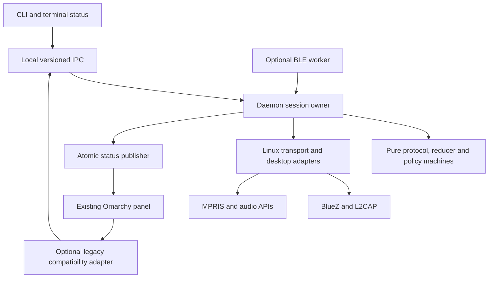

# Rust daemon port and reliability plan

Status: proposed implementation plan, no milestones completed by this document.

Target: this Rust workspace. Behavioral reference: `../omarchy-pods/daemon`,
reviewed at `fff7fec`. Rust baseline: `fc50c5a` plus the local status-view and
confirmed-control changes developed in this session. Preserve those uncommitted
changes when creating the implementation branch; do not reset or overwrite them.

## 1. Outcome and scope

Build a dependable Linux AirPods service with a reusable protocol core, a thin
CLI, and compatibility with the existing Omarchy panel. Primary acceptance
hardware is AirPods Pro 2 USB-C on this Omarchy installation. Other models and
Windows remain supported to their verified extent, without claiming equivalent
hardware validation.

The first complete release must work with **BLE absent at build time and disabled
at runtime**. ANC, connected battery, ear detection, controls, IPC, reconnect,
suspend/resume, and status publication must not depend on scanning or BLE keys.

Port observed behavior and regression cases, not the Qt implementation or its
failure modes. The service must not restart WirePlumber automatically, silently
change the host Bluetooth identity, run as root by default, or infer audio
quality solely from a codec's bitrate.

Baseline evidence:

- 42 Rust unit tests and one documentation test passed; Clippy passed.
- Connected battery, metadata, ear state, and ANC notifications worked on Pro 2.
- Off/ANC and Transparency/ANC changes were confirmed on the physical device.
- CA and single-earbud ANC have command builders and automated exchange tests;
  their mutation paths have not yet been hardware-accepted in this session.
- The Omarchy JavaScript model checks passed. Its C++ suite was inspected but
  not executed here: CMake/Ninja and Qt Bluetooth development dependencies were
  unavailable. Its source and documented behavior are reference evidence, not
  proof that every feature works on this machine.

## 2. Feature disposition and parity map

| Capability | Current Rust implementation | Planned disposition | Reference |
| --- | --- | --- | --- |
| ANC/Off/Transparency/Adaptive | Newly added confirmed direct commands | Keep syntax; move exchanges into the persistent session owner | `daemon/main.cpp`, `airpods_packets.h` |
| CA and single-earbud ANC | Newly added commands | Retain confirmation; add model/capability validation | `BasicControlCommand.hpp`, `enums.h` |
| Adaptive noise level | Incoming raw setting, no CLI mutation | Typed 0–100 control, reject unless Adaptive is confirmed | `ipcverb.hpp`, adaptive setter |
| Ear behavior | Simple automatic media behavior | Persist off/one-removed/both-removed host policies | `eardetection.hpp`, `mediacontroller.cpp` |
| Partial earbud/case battery | Parser exists; missing fields default internally | Preserve absent readings, explicit availability and freshness | `battery.hpp`, `tst_battery.cpp` |
| Headset battery | No equivalent aggregate behavior | Add typed headset component and schema support | `battery.hpp`, status serializer |
| Model support | Older model map | Port verified model/capability data, including Pro 3/Max 2 where reference evidence exists | `enums.h`, `tst_enums.cpp` |
| Reconnect and watchdog | Initial retry only | Persistent supervisor with stale-task cancellation | `controlreconnect.hpp`, `tst_controlreconnect.cpp` |
| Suspend and adapter/BlueZ recovery | Incomplete | Explicit lifecycle events and reconciliation | `systemsleepmonitor.hpp`, `BluetoothMonitor.cpp` |
| Status and controls for panel | Terminal only, no persistent IPC | Versioned native API plus optional legacy adapter | `statusJson()`, `ipcpath.hpp`, `Service.qml`, `Model.js` |
| Published state file | None | Atomic, private, on-change publication | `writeStateFile()`, status-schema knowledge document |
| Media pause/resume | Shell commands and a boolean ownership flag | Opt-in, per-player confirmed ownership | `mediacontroller.cpp`, player watcher |
| Audio profile recovery | Simple default-output/profile commands | Preserve session policy by default; targeted opt-in recovery | `profilechoice.hpp`, `capturematch.hpp` |
| Missing output/input or wrong route | No structured audio health model | Observe node/profile/route state; expose explicit repairs and separately opt-in routing policy | deployed PipeWire/PulseAudio state, desktop panels |
| CA volume ducking | Receives events; no application behavior | Optional, ownership-aware volume policy | `handleConversationalAwareness()` |
| Low-battery notifications | None | Per-component threshold latch with hysteresis | `lowbatterywatcher.hpp`, tests |
| Settings and device identity persistence | Transient state | Versioned private config and optional key storage | `deviceinfo.hpp` |
| Service packaging | None | Hardened systemd user service and migration instructions | `librepods.service` |
| BLE proximity/case/lid telemetry | Parser and scanner, integration defects | Later compile-time/runtime opt-in module | `ble/`, `bleDeviceFound()` |
| Rename and long-press settings | Core builders, no service API | Add after core parity with captured confirmations | protocol builders, upstream packet evidence |
| Connect/disconnect/forget | Not exposed as service actions | Keep normal connection management in BlueZ/desktop; add explicit typed actions only if required by an actual client | reference control verbs |
| Hearing aid/custom transparency | Partial constants/builders | Research/experimental only until full request/response evidence and hardware tests exist | separate reference script |
| Android relay, multipoint, head tracking | Experimental helpers or unconditional streaming | Separate experimental scope; no automatic head tracking or handoff in the normal service | `crossdevice`, upstream research |
| QR, tray, embedded GUI, self-autostart | Not present | Do not port into the daemon; Quickshell and systemd own presentation and startup | reference GUI integration |
| Five-percent volume snapping | Not present | Optional compatibility behavior, never a prerequisite for control | `snaptogrid.hpp` |

No capability is declared supported merely because an enum or packet builder
exists. Unknown model/firmware values remain observable and unsupported mutations
fail explicitly. An unsupported Off mode must not cause retries or a false success.

## 3. Architecture and ownership

Proposed code organization:

| Location | Responsibility |
| --- | --- |
| `librepods-core/src/protocol/` | Wire formats, typed commands/events, parsing and encoding |
| `librepods-core/src/device/` | Reported state, partial updates, model capabilities, provenance |
| `librepods-core/src/policy/` | Deterministic recovery, command, media and notification decisions |
| `librepods-daemon/` (new crate) | Tokio coordination, one session owner, queues, deadlines, publication and IPC |
| `librepods-linux/` | BlueZ/L2CAP, sleep events, filesystem/socket operations, MPRIS/audio and notifications |
| `librepods-cli/` | Argument parsing, API client and terminal presentation |
| `librepods-windows/` | Existing Windows adapters; implement common contracts or return explicit Unsupported |
| `tests/fixtures`, `tests/integration`, `fuzz/` | Sanitized captures, service/fault tests and fuzz targets |

The core must remain free of OS I/O and Tokio. Policies receive explicit time and
events, and return actions. Move the blocking receive loop and `Instant`-driven
execution from the current `protocol/settings.rs` into daemon orchestration;
retain encoding and confirmation decisions in core.

Before that refactor, update `.github/copilot-instructions.md` and `QWEN.md` in
the same change: the current instruction puts all mutation in CLI
`apply_to_state()`. Replace it with **all device state changes pass through the
single core reducer**. Document the new crate boundary, preserving the ban on
protocol logic inside platform adapters. Do not simply bypass existing rules.

One selected device, one L2CAP connection owner, one packet reader, and one
serialized command exchange are the initial scope. The owner dispatches every
packet to state reduction and pending-command matching. IPC handlers, telemetry
workers, and UI code never read or write the Bluetooth socket directly.

## 4. State and protocol correctness

- Separate reported values, requested values, host policies, and transient
  pending operations. Defaults must never masquerade as device observations.
- Represent measurements as unknown/available/stale with source, session
  generation and last-observed time. Native API values may be null; compatibility
  serialization translates them to the existing panel's expected shape.
- Apply partial battery reports as patches. A left-only update must not erase a
  known right/case value. Preserve real 0%, reject out-of-range levels, and retain
  unknown status/component values without inventing a meaning.
- Preserve in-ear/out-of-ear/in-case/unknown as distinct states; derive booleans
  only at presentation boundaries. Never label primary/secondary as left/right
  without supporting evidence.
- Keep last-known battery separate from current availability. On disconnect,
  invalidate command-confirmation state and pending requests; old telemetry may
  remain visible only as stale. Use monotonic time internally, wall time for
  serialized observation timestamps, and a daemon instance identifier across
  process restarts.
- Validate opcode-specific frame shape, reserved bytes where documented,
  counts, lengths, duplicate components and UTF-8. Document whether extra bytes
  are allowed per opcode. Preserve unknown packets; reject malformed known
  packets without partially mutating state.
- Maintain datagram boundaries and detect oversized/truncated L2CAP datagrams
  with a receive API that exposes truncation. Bound parsing work and allocations.
- Keep protocol constants in the established packet modules. Every supported
  packet family needs a sanitized capture, expected parse and malformed cases.
- Maintain separate DTOs for public status. Never serialize internal state
  containing IRK/encryption keys or dump that state on disconnect.

## 5. Session lifecycle, cancellation and recovery

States: `WaitingForAdapter`, `WaitingForDevice`, `Connecting`,
`AwaitingHandshake`, `AwaitingFeatures`, `Subscribing`, `Ready`, `Recovering`,
`Suspended`, `Stopping`. Keep BlueZ device connection, AACP readiness, audio
transport state and service availability separate.

Requirements:

1. Subscribe before obtaining the initial BlueZ snapshot, buffer/reconcile
   intervening signals, and deduplicate by object/device identity. Monitor
   adapter objects and BlueZ service-owner changes as well as device properties.
2. Use nonblocking, close-on-exec transport operations with real monotonic
   deadlines. Wrapping a blocking syscall/task in an async timeout is insufficient
   unless cancellation also closes/unblocks the underlying operation.
3. Apply separate limits to connect, handshake stages, IPC reads/writes,
   command exchanges and external API calls. Command deadlines include queueing
   and any connection preparation; none restart on unrelated traffic.
4. Match expected handshake packets, retaining interleaved notifications. Never
   log handshake completion merely because a different packet arrived.
5. Retry transient failures with capped exponential backoff and jitter. Initial
   policy: first recovery probe around 750 ms, ladder capped near 16 s, bounded
   attempts per round and a 30 s reconciliation watchdog. Make constants named
   and testable; adjust from measured behavior, not arbitrary configurability.
6. Tag connections, timers and async replies with generations. A stale reply
   must not revive a disconnected device, publish old status, or change a profile.
7. Treat intentional disconnect, absent pods, adapter-off and suspend differently
   from a broken AACP channel while BlueZ still holds the device. A watchdog may
   probe readiness; it must not continually reclaim headphones from a phone.
8. On suspend, cancel pending work, stop optional scans, invalidate exchanges and
   release owned resources. On resume, reconcile BlueZ and reconnect only after
   readiness. Handle multiple sleep notifications idempotently.
9. On BlueZ restart, rebuild proxies/subscriptions and enumerate again. On loss
   of the user bus, degrade desktop automation while retaining core control if
   possible; recover desktop adapters independently.
10. On shutdown, reject new commands, cancel exchanges, close the socket to
    unblock reads, stop workers, publish stopped state, remove owned runtime
    artifacts and join tasks within a bounded budget. SIGTERM and Ctrl+C follow
    the same path. SIGKILL recovery is handled on the next startup.

## 6. Error and command contract

Use structured errors with operation, stage, retryability, optional OS/BlueZ
cause, and session/request identifiers. Keep stable machine codes separate from
human-readable context. At minimum: invalid input, unsupported capability,
permission denied, adapter unavailable, device unavailable, connect failure,
handshake timeout, malformed frame, command timeout, superseded, cancelled,
queue full, service unavailable, IPC version mismatch, persistence failure and
internal failure. Unknown OS errors retain their original source.

Commands return one of confirmed, already set, rejected, superseded, cancelled,
timed out or outcome unknown. If a write succeeds but confirmation is lost,
return **outcome unknown**: the setting may have changed. Do not automatically
replay mutations after reconnect. A caller timeout must not leave an unsent
command queued to execute later.

For confirmations, observe a valid baseline where available and a newer
matching notification after dispatch. AACP has no application request ID, so
document that this confirms the observed target state, not exclusive attribution
to our write. Serialize conflicting writes, validate device/session generation,
and never accept an old connection's cached state. An already-set result requires
a fresh, valid observation from the active connection.

Bound queues and use latest-desired-value coalescing for repeated slider updates.
Return explicit superseded results to replaced requests. Do not coalesce actions
whose semantics differ. Resolve cycle commands inside the owner using confirmed
state; reject a cycle if its starting state is unknown.

Rate-limit repeated malformed/unknown-frame logs, preserve diagnostic counters,
and keep the service alive for isolated malformed frames. Repeated framing
failures may trigger bounded session recovery. Ordinary inactivity is not a dead
connection unless a verified protocol liveness check establishes that fact.

## 7. IPC, status and panel compatibility

Native contract, initially version 1:

- Unix-domain stream socket under `$XDG_RUNTIME_DIR/librepods-rs/control.sock`.
  Private runtime directory, owner-only socket, same-user peer verification.
  No TCP listener and no arbitrary packet-send endpoint.
- Explicit newline-delimited JSON framing with an initial 16 KiB frame cap,
  protocol version, request ID, typed operation and bounded payload. Test partial
  frames, combined frames, oversized messages, stalled clients and backpressure.
- Support status snapshots, subscribe/watch, capabilities, confirmed setting
  writes, host ear policy, diagnostics and explicit reconnect. No silent fallback
  to direct Bluetooth when a running daemon rejects a request.
- CLI prefers the daemon. Preserve existing flag spellings; retain an explicit
  `--direct` diagnostic mode that refuses to compete with a running owner.
  One-shot commands exit predictably; `--status` subscribes to live state.
- Keep status revisions monotonic within a daemon instance. Bound slow-client
  queues and coalesce replaceable snapshots without dropping command results.
- Native file: `$XDG_STATE_HOME/librepods-rs/status.json`, written atomically
  through an owner-only temporary file in the same directory, only on changes.
  Include schema version, daemon instance, revision, lifecycle and freshness.
  On I/O failure, retain in-memory state and IPC; report degraded publication.
- Use an owner lock before socket/file cleanup. Never remove another process's
  socket, unexpected file or symlink. After crashes, stale status is not proof
  the daemon is alive: clients use instance/freshness plus a live service probe.

Optional legacy adapter:

- Match the actual current `statusJson()` output and `Model.js` parsing behavior,
  including noise-mode numbering, capability flags, headset battery, lid state,
  availability, optional fields and counter semantics. The knowledge document
  and actual serializer differ on some field-presence details; fixtures from
  source/runtime, not prose alone, settle the contract.
- Translate `noise:*`, `ear:*`, `ca:*`, `onebud:*`, `adaptive:N`, and `status`.
  New native operations return typed errors; document the limits of older clients
  that cannot read mutation acknowledgements.
- Prefer configuring the panel's existing control-path option to a compatibility
  client. Publishing the legacy state file requires explicit compatibility mode
  and an ownership check. Never have both daemons publish the same path or claim
  the same AirPods simultaneously.
- Additive metadata must not break the panel. Change incompatible schema versions
  deliberately, and run the actual JavaScript model tests against Rust-generated
  fixtures.

## 8. Desktop features and audio policy

Default control-only mode leaves routing, codec and playback policy to the
desktop. Host automation is separately opt-in and persists as user preferences.

Output/input availability and routing:

- Disabling LibrePods media automation must never disable system playback or
  recording. Document that `--no-media`, status-only mode and direct setting
  commands leave audio management with the desktop.
- Observe output (sink), input (source), profile, node availability, active stream
  routes, defaults, mute and volume as separate properties. A Bluetooth device
  connection or an active AACP channel does not prove usable playback/capture.
- Distinguish adapter/device disconnected, profile off, no suitable profile,
  profile activation pending, missing sink/source, muted output, zero volume,
  wrong default device, an application pinned elsewhere and audio-server loss.
  Report the specific state instead of a generic Bluetooth failure.
- Add native status fields for audio health, selected profile, available
  playback/capture capabilities, current default input/output, routing-policy
  mode and last recovery result. Keep node IDs transient: re-resolve stable
  device identity after node recreation or server restart.
- Default policy observes and preserves user choices. An opt-in recovery policy
  restores a previously usable selected-device profile when it disappears or is
  off, after a settlement window and a live/unknown capture check. Retry only the
  selected device with bounded backoff; reset the budget only after real recovery
  or a new explicit action, not on every repeated notification.
- Default-device changes, stream moves, profile selection and unmute are distinct
  explicit native API actions. A separate opt-in routing policy may select the
  AirPods after connection, but records the prior default and yields immediately
  to subsequent user changes. It must not continually force the AirPods back.
- Changing the default output does not prove existing streams moved. Inspect the
  selected stream's target and move it only on an explicit request or under the
  opted-in routing policy. Preserve application-specific routing and report
  unsupported stream movement as such.
- A source absent from the current playback profile is not automatically broken.
  Discover whether available profiles advertise capture. A request to use the
  AirPods microphone may require a different profile and must explain the
  resulting playback change before applying that explicit selection. No headset
  profile switch occurs merely because a microphone node is missing.
- Keep the desktop-selected external microphone valid while AirPods playback
  continues. Do not force the AirPods to be the input simply because they are the
  output. Report separately advertised, created and actively recording sources;
  internal/loopback nodes are not proof of a usable application microphone.
- High-resolution microphone-over-AACP support remains a separate experimental
  milestone with codec, transport and real recording validation. Do not advertise
  simultaneous high-quality playback/capture from an untested packet path.
- After disconnect/server restart, recover only settings owned by an explicit
  routing action or enabled policy. Restoration must not overwrite a user's new
  output/input selection. Audio failures degrade the audio subsystem while ANC,
  battery, IPC and the AACP session remain usable where possible.

Ear/media policy:

- Off, pause-on-one-removed and pause-on-both-removed modes.
- Initial wear snapshot establishes a baseline and never changes playback.
- Debounce transient both-out reports around listening-mode transitions. Repeated
  reports do not perpetually extend the first deadline; new in-ear reports cancel
  it by generation.
- Operate only when the selected AirPods are the intended active output. Unknown
  routing or capture state suppresses disruptive actions.
- Record exact MPRIS bus owner, player identity and confirmed Playing-to-Paused
  transition. Resume only players this service paused, if they still qualify.
  Manual playback, owner replacement, output change or user-bus loss invalidates
  ownership. No unsolicited playback after recovery or startup.

Audio recovery, if enabled:

- Inspect structured device/profile state rather than parse localized `wpctl
  status` output. Support the deployed PipeWire/PulseAudio interfaces without
  assuming a command's presence proves server availability.
- Preserve a usable current playback profile by default. Offer an explicit
  highest-bitrate compatibility policy if needed to match the Omarchy daemon;
  bitrate preference is a policy, not a general audio-fidelity ranking.
- Defer any profile mutation while capture is live or unknown. Cancel stale
  activation ladders on disconnect and never switch a headset profile implicitly.
- Permit only targeted, bounded recovery of the selected device. Do not restart
  WirePlumber, change the default sink, disable an unrelated card or edit system
  config as a hidden recovery action.
- Optional CA ducking captures the exact sink, prior volume and ownership. Restore
  only if that sink still exists and the user has not changed the volume; never
  overwrite a new output device's settings. Test repeated speech-start/stop and
  disconnect during ducking.
- Low-battery latches operate only on fresh available readings, with separate
  components and hysteresis (reference defaults: trigger 10%, reset 15%, charging
  clears the latch). Notification failures do not break control. Optional volume
  snapping remains a distinct opt-in preference.

Persist host preferences atomically with a schema version and validation.
Device preferences remain distinct from confirmed device state. Protect optional
BLE keys in a separate store; never put keys in public status, logs or fixtures.

## 9. BLE is optional in two independent ways

Compile-time `ble` feature, disabled by default, forwards to optional scanner and
crypto dependencies. Confirm with `cargo tree` that the no-BLE executable does not
pull in the BLE backend. Keep existing pure parser tests available through an
appropriate test feature without forcing the runtime dependency into production.

Runtime `ble.enabled = false` remains the default even in a BLE-capable build.
Attempting to enable scanning in a build without support returns a clear error.
Enabling it requires no restart of the core session.

The worker uses a continuously driven runtime, bounded channels, event-based
updates, cancellation and independent backoff. Scan permission errors, missing
adapters, malformed advertisements and worker failure degrade only BLE telemetry.
Pause scanning during connection recovery and suspend; permit scanning while
connected only after controller-specific coexistence tests. Model the adapter
shared-resource policy explicitly rather than assuming all radios behave alike.

Verify IRK identity before assigning an advertisement to the selected AirPods.
Retrieve and persist keys only through an explicit supported flow. Validate
decrypted values and sentinel states; unauthenticated plausible bytes alone do
not establish device identity. Merge BLE and AACP values with documented source
priority and freshness. Never use BLE readings as command acknowledgements.
Case/lid telemetry can be missing indefinitely without harming service readiness.

## 10. Quality and testing strategy

Every bug fix starts with a reproducible failure or an explicit unverified
hypothesis. Port meaningful reference regressions, not tests that merely mirror
the current Rust implementation. Preserve provenance and license notices for
ported code/fixtures and document behavioral differences.

| Test layer | Required cases | Runs with no Bluetooth hardware? |
| --- | --- | --- |
| Core parser/encoder | Every variant, exact frames, short/oversized/duplicate/unknown fields, round trips | Yes |
| Reducer | Partial updates, true zero vs unknown, stale generations, reconnect reset, source priority | Yes |
| Policy machines | Fake-clock backoff, watchdog, debounce, notification latches, manual overrides | Yes |
| Command engine | Interleaved frames, baseline vs new observation, queue expiry, missing/mismatched ACK, disconnect after send | Yes |
| Transport | Unix socket peer harness, nonblocking deadlines, truncation, cancellation, interrupted calls, EOF | Yes |
| BlueZ | Private bus/fake service: initial snapshot races, late UUIDs, adapter add/remove, service-owner restart | Yes |
| MPRIS/audio | Fake players and audio adapters: ownership, capture live/unknown, owner replacement, recovery cancellation | Yes |
| Routing/source health | Profile off, missing/recreated nodes, wrong default vs pinned stream, muted/zero volume, capture-capable profile absent, explicit input selection and manual override | Yes |
| IPC/filesystem | Real local client/server, framing, peer checks, stale sockets, permissions, disk-full/read-only writes, crash cleanup | Yes |
| End-to-end daemon | Fake BlueZ plus emulated AACP peer and real CLI, concurrent clients, restart and exit codes | Yes |
| Compatibility | Rust status fixtures consumed by `Model.js`; legacy verbs and schema migration | Yes |
| BLE isolation | Feature absent, disabled, permission failure, scan failure while commands and recovery continue | Yes |
| Hardware | Pro 2 firmware behavior, actual audio continuity, suspend/reconnect, optional scan coexistence | No |

Test infrastructure must be part of the first milestones, not added after the
daemon is complete. Inject clocks, randomness and adapter results. Use paused
Tokio time for orchestration timers; no real sleeps in policy tests. Use private
test buses and temporary directories, never the user's live players or config.
Hardware-changing tests are separately invoked and restore the captured initial
settings in cleanup, reporting any failed restoration.

Add property tests for arbitrary bytes, bounded allocations and state-machine
event sequences. Add `cargo-fuzz` targets for AACP, BLE, IPC and persisted config;
seed them with sanitized observed frames and keep minimized regressions in-tree.
Use corpus replay and scheduled fuzz runs; no short fuzz run is evidence of
exhaustive safety. Add Miri where supported for pure code and targeted sanitizers
for unsafe platform boundaries. Record platform/tool limitations explicitly.

Measure coverage with `cargo-llvm-cov`. Establish the baseline before setting the
gate. Release targets: at least 90% line coverage for core plus pure policy,
80% for Linux service code exercised by unit/integration tests, and a documented
test for every critical recovery/error transition. Track branch coverage where
supported. New/changed critical code should meet a 90% changed-line target.
Exclude only generated or genuinely target-inapplicable code, with reasons; test
counts and coverage percentages do not replace outcome assertions or hardware
acceptance.

CI matrix:

- Pin a documented Rust version/MSRV and use locked dependency resolution.
- Formatting and Clippy with warnings denied; debug and release builds.
- Linux minimal/default no-BLE build and tests; BLE-enabled build and tests.
- Core compile check for Android, plus current Windows build/tests. New platform
  operations must compile and return Unsupported explicitly until implemented.
- Deterministic integration and legacy schema checks; enforce per-test timeouts.
- Coverage artifacts and no-regression gates; dependency/license checks with
  reviewed exceptions and no broad lint suppression.
- Scheduled fuzzing, stress and hardware jobs separate from ordinary PR jobs.
  Avoid compiling ordinary Windows-dependent adapters with Linux feature flags.

## 11. Delivery milestones and acceptance gates

| Milestone | Concrete deliverable | Depends on | Exit criteria |
| --- | --- | --- | --- |
| M0: baseline | Preserve local changes, document fixtures/provenance and reproduce known gaps | None | Existing tests and hardware commands remain green; known failures recorded separately |
| M1: pure domain | Typed observations/capabilities, reducer, command/policy machines, boundary documentation | M0 | Partial battery and unknown-value regressions pass; deterministic core tests; Android compile check |
| M2: transport | Nonblocking cancellable datagrams and structured adapter errors | M1 | Connect/send/read deadlines and truncation tested; cancellation closes resources; no new privilege requirement |
| M3: session service | New daemon crate, single owner, lifecycle, reconciliation, bounded queues | M2 | Fake BlueZ/AACP end-to-end suite survives adapter loss, missed events, BlueZ restart and control-only disconnect |
| M4: controls/API | Confirmed commands, status/watch, thin CLI, local file publication | M3 | Concurrent clients cannot steal packets; expiry prevents late writes; atomic publication and crash cleanup pass |
| M5: Omarchy parity | Legacy schema/client adapter, capabilities, adaptive level, host preferences | M4 | Actual panel model tests pass with Rust fixtures; no unsupported controls exposed; default no-BLE service works |
| M6: desktop policies | Audio health and explicit routing/source actions; opt-in ear/media, CA ducking, notifications and targeted recovery | M4–M5 | Missing-node/profile-off, routing, capture and ownership regressions pass; no global audio restart or unsolicited resume |
| M7: packaging | Hardened user unit, diagnostics, migration and rollback | M5–M6 | Start/stop/restart/install/uninstall tested with production restrictions; no root/capabilities required for verified basic setup |
| M8: optional BLE | Feature-isolated scanner, keys, validated merge and controller coordination | M3–M7 | Entire baseline passes with feature absent/disabled/failing; separate BLE hardware matrix passes |
| M9: release hardening | Coverage, fuzz regressions, soak and migration evidence | M7; M8 only for BLE release | Release checklist below met; unresolved limits published |

M8 is not on the critical path for the first stable no-BLE release. Do not delay
recovery, IPC and testing work to implement optional proximity features.

Suggested review units within milestones: reducer; transport; BlueZ monitor;
session supervisor; command engine; native IPC; publisher; compatibility adapter;
ear policy; MPRIS adapter; audio policy; notifications; packaging; optional BLE.
Each unit includes its own tests and documentation. Avoid one large rewrite PR.

## 12. Performance, diagnostics and release acceptance

Measure release builds with BLE off/on separately. Initial budgets: idle CPU
below 1% of one core over ten minutes, bounded memory with no upward growth over
a 24-hour soak, a provisional no-BLE RSS target of 30 MiB, graceful stop within
two seconds, idle-local-IPC status latency below 100 ms at p95, and connected
command confirmation below two seconds at p95 when firmware responds normally.
Reconnect backoff is excluded from command latency but included in published
recovery measurements. Report hardware, firmware, adapter and sample size;
revise budgets with evidence rather than hide failures behind averages.

Diagnostic output includes lifecycle stage, last successful observation, error
code, retry count/deadline, session generation, queue pressure and BLE health.
Do not log names, addresses, raw packets or keys by default. A deliberate local
capture mode requires redaction before sharing. Keep tracing bounded and cheap
when disabled. A doctor command reports missing optional features separately
from failures that prevent AACP control.

First-release hardware checklist, with recorded before/after state:

1. At least 20 successful Off/ANC/Transparency transitions where firmware permits,
   plus Adaptive, CA, single-earbud ANC and adaptive-level checks as supported.
2. At least 20 case/reconnect cycles; control socket loss while BlueZ stays
   connected; startup before adapter; Bluetooth off/on; BlueZ restart.
3. At least 10 suspend/resume cycles and reconnect during queued commands.
4. Continuous playback during mode changes, with no unexpected profile/default
   output changes. Capture and ear automation tested separately when enabled.
   Exercise a disabled profile, sink recreation, a stream pinned to another
   output, mute/zero volume and audio-server restart. Recovery must identify each
   condition correctly and obey its explicit action or opt-in policy. Verify
   that the external microphone remains selected unless the user explicitly
   chooses AirPods capture; restore the captured original profile and routes.
5. Unknown/stale case battery displayed correctly with BLE absent. One-earbud
   reports do not erase the other reading.
6. Two clients issuing conflicting commands receive explicit, bounded results;
   all mutations remain serialized. SIGTERM, SIGKILL and client disconnect do not
   replay uncertain commands on restart.
7. At least one 24-hour no-BLE soak with memory/CPU/log-volume evidence. BLE has
   its own acceptance run and cannot substitute for this baseline.
8. Migration and rollback work without re-pairing, host identity spoofing, root
   execution or undocumented changes to audio/Bluetooth configuration.

Keep features experimental when their hardware matrix is incomplete. Unit tests
alone do not justify claims about audio quality, reconnect reliability or device
firmware support.

## 13. Deployment and rollback

- Package a systemd user unit tied to the graphical session. Use private state
  permissions, no new privileges, no ambient capabilities, restricted address
  families and filesystem access consistent with actual adapters. Test those
  restrictions under the unit, not only from a terminal. Do not rely on setcap
  working through a NoNewPrivileges service.
- Default operation does not need Bluetooth pairing privileges, network access,
  BLE or desktop automation. If a host denies an operation, report the actual
  denial; do not prescribe blanket capabilities or change the system policy.
- Use a separate development socket/state namespace until compatibility acceptance.
  Capture current service/config state before switching. Stop the old daemon,
  start Rust without automation/BLE, verify status and commands, then enable the
  optional legacy publisher/client path. Do not run both connection owners.
- Keep the old binaries/config available. Rollback stops Rust, removes only its
  owned runtime artifacts, restores the saved panel/service selection, and starts
  the old daemon. No automatic package removal, pairing changes or config resets.
- Verify file ownership after upgrades, config migration idempotence and clean
  shutdown. Never overwrite a newer or unrecognized config schema.

## 14. Implementation order and deferred decisions

Start M0–M4 with BLE and desktop automation disabled. These deliver a service
that can reliably replace the direct command prototype. M5 provides panel parity;
M6 and M7 make it suitable for daily desktop use. Only then implement optional BLE.

Resolve these decisions with code or hardware evidence at the named milestone:

- M1: exact model/capability table and ambiguous ear/unknown command values.
- M2: deployed BlueZ permission behavior and safe adapter selection on this host.
- M4: minimum compatible panel schema and native framing/size limits under load.
- M6: whether best-bitrate compatibility is actually wanted after audio tests;
  do not inherit it as an unexamined quality claim.
- M8: safe scan duty cycle per adapter, key retrieval validity and case freshness.
- M9: Windows parity claims and experimental features to exclude from release.

These are implementation checkpoints, not reasons to postpone the independent
no-BLE recovery and testing work.

## Reference material

Local references: `../omarchy-pods/daemon/UPSTREAM.md`, `controlreconnect.hpp`,
`battery.hpp`, `media/profilechoice.hpp`, `media/capturematch.hpp`,
`lowbatterywatcher.hpp`, `librepods.service`, daemon regression tests,
`../omarchy-pods/knowledge/librepods-status-schema.md`, `Model.js`, `Service.qml`,
and this workspace's `AUDIT.md` and instruction files. The Omarchy source is a
behavioral reference; porting code must retain the relevant provenance/notices.

Official implementation/testing references:

- [Cargo optional features and dependencies](https://doc.rust-lang.org/cargo/reference/features.html)
- [Tokio graceful shutdown](https://tokio.rs/tokio/topics/shutdown)
- [Rust Fuzz Book](https://rust-fuzz.github.io/book/cargo-fuzz.html)
- [cargo-llvm-cov documentation](https://github.com/taiki-e/cargo-llvm-cov)
